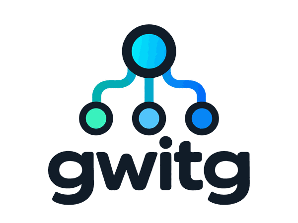

<p align="center">
  
</p>

<p align="center">
  <strong>Delegate independent work to subagents without turning the parent agent into a progress monitor.</strong>
</p>

<p align="center">
  <a href="./LICENSE"></a>
  <a href="https://github.com/Twil3akine/gwitg/releases"></a>
</p>

<p align="center">
  <strong>English</strong> | <a href="./README.md">日本語</a>
</p>

# gwitg

`gwitg` is an Agent Skill for **OpenAI Codex** that delegates suitable independent work to subagents and runs independent tasks in parallel when appropriate.

Its central rule is simple: **after delegation, the parent agent should not become a progress monitor**. While delegated workers run, the parent continues other independent work or waits for completion instead of repeatedly polling status or inspecting partial output.

```text
parent agent
├─ investigate-api
├─ tests
└─ review

        ↓ completed results

parent integrates and validates
```

Occasional lifecycle checks are allowed when coordination or an explicit user status request requires them, but repeated polling and progress monitoring are not. The detailed operational rules live in [SKILL.md](SKILL.md).

## Compatibility

`gwitg` is currently designed for **OpenAI Codex** and relies on Codex subagent behavior and controls such as `/subagent`, worker model selection, and reasoning-effort selection.

It should not be presented as a generic Claude Code, Cursor, Copilot, or cross-agent skill unless those environments are explicitly supported and validated in the future.

## Quick Start

### Install for your user account

```sh
git clone https://github.com/Twil3akine/gwitg ~/.codex/skills/gwitg
```

### Install for one repository

Run the following inside the target repository:

```sh
mkdir -p .codex/skills
git clone https://github.com/Twil3akine/gwitg .codex/skills/gwitg
```

You can explicitly ask Codex to use the skill:

```text
Use gwitg to work on this task.
```

You can also let Codex select the skill automatically.

## How it works

The parent delegates work that can proceed independently, has clear inputs, and can be completed without frequent synchronization.

Typical candidates include:

- repository investigation
- bug investigation
- well-defined implementation
- test writing
- independent code review
- documentation investigation
- codebase search
- self-contained experiments
- validation against explicit acceptance criteria

When multiple tasks are independent, gwitg prefers parallel execution where dependencies allow it.

The user-selected worker profile takes precedence. If no profile is explicit and delegation or profile choice is ambiguous, use the profile recommended by a valid common-format judge result. Otherwise, when the parent decides to delegate, the default is `standard`. Keep the profile name with its resolved model and reasoning effort, and pass all three to descendants so they reuse the same settings without rereading configuration. The built-in `standard` profile preserves the previous `6-luna` / `high` setting. Do not silently replace unsupported settings with different ones. Keep `/fast` at the environment default.

### Rules while a worker is running

Lifecycle states such as `running`, `completed`, and `failed` may be checked when needed.

The parent must not:

- repeatedly check status at short intervals
- alternate sleep and status checks
- inspect partial output or intermediate logs for progress
- restart, replace, accelerate, or reconfigure a worker merely because it appears slow

Passive completion notifications are preferred when available.

### Allowed corrections during execution

A parent may send a running subagent only:

- a correction to a false premise
- a newly discovered constraint
- an instruction to stop

These exceptions do not permit ordinary scope changes or additional tasks. If a new constraint makes the original assignment impossible, the worker should stop and report why.

## Delegation Judge

When it is unclear whether to delegate or which profile to use, gwitg can optionally use an external decision model as an advisory judge. Do not call a judge when both decisions are clear.

Supported values are:

| Value | Judge |
| --- | --- |
| `clef` | Clef judgment tool available in the environment |
| `jev` | Jev judgment tool available in the environment |
| `none` | parent agent decides by itself |

Selection priority is:

```text
1. explicit user selection for the current task
2. <project-root>/.gwitg/decision-model
3. ~/.config/gwitg/decision-model
4. none
```

### Common configuration

```sh
mkdir -p "$HOME/.config/gwitg"
printf '%s\n' clef > "$HOME/.config/gwitg/decision-model"
```

### Project-specific override

```sh
mkdir -p .gwitg
printf '%s\n' jev > .gwitg/decision-model
```

To disable external judgment for a project:

```sh
printf '%s\n' none > .gwitg/decision-model
```

The setting is read once at the start of a task and reused for that task. Invalid or unreadable settings are reported instead of silently falling back to another external judge.

This setting does not install or provision Clef or Jev. The corresponding callable tool or connection must already exist in the runtime environment.

The resolver can be run with:

```sh
python3 /path/to/gwitg/scripts/decision_model.py
```

Run it from the task's working directory using an absolute path to the skill script.

### Common judge result

Interpret the result from Clef, Jev, or another judge through this common three-field format:

```yaml
delegate: true
profile: light
reason: Independent repository search with bounded scope
```

`delegate` is required and must be a boolean. `profile` is required and must name a configured worker profile when `delegate` is `true`; it must be `null` when `delegate` is `false`. `reason` is a required, non-empty short explanation. Missing or extra fields, invalid types, an empty reason, or inconsistent values make the entire result invalid. Do not use only part of an invalid result; the parent decides.

The judge recommends a profile name only. It does not select a concrete model, reasoning effort, or `/fast` state, and the parent makes the final delegation decision. Judge-specific invocation and connection details remain environment-specific.

## Worker Profiles

Worker profiles name a worker model and reasoning effort. The built-in profiles are `light`, `standard`, and `strong`; the default is `standard`, which preserves `6-luna` / `high`. `/fast` is independent of the worker profile.

The resolver reads `.gwitg/worker-profiles.json` at the project root first, then `~/.config/gwitg/worker-profiles.json` only if the project file is absent. If both are absent, it uses the built-in settings below. The selected file replaces the whole profile list; the files and built-in settings are not merged. An invalid or unreadable project file is an error and does not fall back to common configuration.

```json
{
  "profiles": {
    "light": {"model": "6-luna", "reasoning_effort": "low"},
    "standard": {"model": "6-luna", "reasoning_effort": "high"},
    "strong": {"model": "6-astra", "reasoning_effort": "high"}
  }
}
```

Resolve a profile from the task's working directory as follows. If omitted, the profile defaults to `standard`.

```sh
python3 /path/to/gwitg/scripts/worker_profiles.py light
```

The resolver returns configured values unchanged and does not check whether the runtime supports them. An invalid configuration or missing profile is an error. Do not silently choose another profile. See [SKILL.md](SKILL.md) for details, including how to pass a parsed judge result to the resolver programmatically.

### Launching a worker

Before spawning, check the current tool's schema and documentation for supported model IDs, reasoning efforts, and context-inheritance options. For example, in a runtime that advertises `gpt-6-luna` and `gpt-6-astra`, built-in `light` and `standard` use `gpt-6-luna`, while `strong` uses `gpt-6-astra`. This mapping depends on the runtime; do not mechanically add a prefix or substitute another setting. Keep the selected profile, resolver values, and established launch ID together and pass them to descendants.

If the spawn tool requires `fork_turns="none"` to set a model or reasoning effort, specify it and pass both resolved settings explicitly. Follow the actual tool contract. When context is not inherited, make the delegation prompt self-contained: state the objective and acceptance criteria, working directory and relevant files, current state and constraints, permitted changes, validation, and expected report. Also provide the selected judge, profile, resolved values, launch ID, and applicable gwitg rules. Never assume the child can read the earlier conversation. If the selected settings cannot be applied, the parent does the work.

## Recursive Delegation

A subagent may delegate independent subtasks to its own subagents when doing so is useful.

```text
parent
├─ investigate-api
│  ├─ inspect-cache
│  └─ inspect-tests
└─ implementation
```

Recursive delegation reuses the selected profile name and resolved worker settings. The same no-polling rule, intervention limits, and conflict-avoidance rules apply.

A worker with children integrates their completed results before reporting completion to its parent.

## Direct user control with `/subagent`

Users may directly inspect or adjust a running subagent through `/subagent`.

The supported direct controls are:

1. inspect current state
2. open the thread
3. enable or disable `/fast`
4. change model or reasoning effort

The parent agent does not proxy thread opening, `/fast` changes, or model/reasoning-effort changes. Those controls remain direct user actions.

## Investigation Reports

For time-sensitive investigation tasks, reports should distinguish when relevant:

- what was checked
- when it was checked
- what time the evidence actually describes
- whether a finding was directly observed in the current state or came from historical material
- what remains unverified

Reading an old document today does not make the document's claims current.

## Repository Layout

```text
gwitg/
├── assets/
│   └── gwitg_logo.png
├── LICENSE
├── README.md
├── README.en.md
├── SKILL.md
├── scripts/
│   ├── decision_model.py
│   └── worker_profiles.py
└── tests/
    ├── test_decision_model.py
    └── test_worker_profiles.py
```

- [LICENSE](LICENSE): MIT License
- [SKILL.md](SKILL.md): operational policy followed by the agent
- [scripts/decision_model.py](scripts/decision_model.py): decision-model setting resolver
- [tests/test_decision_model.py](tests/test_decision_model.py): resolver tests

## Test

```sh
python3 -m unittest discover -s tests -v
```

## Links

- [Releases](https://github.com/Twil3akine/gwitg/releases)
- [Issues](https://github.com/Twil3akine/gwitg/issues)
- [OpenAI: Skills](https://developers.openai.com/api/docs/guides/tools-skills)
- [OpenAI: Build skills](https://developers.openai.com/plugins/build/skills)
- [OpenAI: Multi-agent](https://developers.openai.com/api/docs/guides/responses-multi-agent)
- [Agent Skills specification](https://agentskills.io/)
