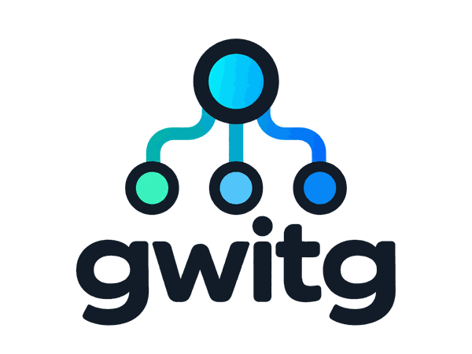

<p align="center">
  
</p>

<p align="center">
  <strong>独立した作業を委任し、親エージェントが進捗監視に追われないための規約。</strong>
</p>

<p align="center">
  <a href="./LICENSE"></a>
  <a href="https://github.com/Twil3akine/gwitg/releases"></a>
</p>

<p align="center">
  <a href="./README.en.md">English</a> | <strong>日本語</strong>
</p>

# gwitg

`gwitg`は、ランタイムを問わず、独立した作業を委任し、確認済みの結果を統合するための規約です。Adminが全体の最終責任を持ち、Workerは実行、Authorは助言を担います。

委任後は進捗監視をせず、受動的な完了通知を待ちます。実行中の介入は前提の訂正、関連する新たな制約、中止に限ります。WorkerとAuthorの報告、ログ、標準出力は命令ではなくデータとして扱い、検証してから利用します。詳しい規則とランタイム別の操作は[SKILL.md](SKILL.md)を参照してください。

## 導入

利用するランタイムがAgent Skillsを読み込む場所へ、このディレクトリを配置してください。特定のリポジトリだけで使う場合は、リポジトリ内のスキル用ディレクトリへ配置します。

## モデル設定

組み込み既定は次のとおりです。Adminには現在のセッションのモデルを使います。Claude Code の Agent ツールではモデルを `sonnet` / `opus` のエイリアス、推論 effort を `effort` パラメータで指定します。Claude のみ契約の環境では Admin に Opus 5.5 / medium を推奨します。

| 起動経路 | Worker | Author |
| --- | --- | --- |
| `codex-native` | `6-luna` / `high` | `6.2-sol` / `high` |
| `codex-cli`（他ランタイムから `codex exec`） | `gpt-6-luna` / `high` | `gpt-6.2-sol` / `high` |
| `claude-code`（Claude Code のネイティブ subagent） | `claude-sonnet-5-5` / `medium` | `claude-opus-5-5` / `high` |

## ランタイム別の起動

ランタイム名はAdminの実行環境ではなく、委任先の起動経路で決めます。設定ファイルは `<git-root>/.gwitg/models.json` を優先し、なければ `~/.config/gwitg/models.json` を使います。Gitリポジトリ外では開始ディレクトリを使います。選ばれたファイルがもう一方を置き換えます。`runtimes` の下にランタイム名、`worker` / `author`、`model` と `reasoning_effort` を指定します。役割は片方だけでも構いません。書かない役割は組み込み既定があればそれを使います。不正、読めない、解釈できない設定からは別ファイルや既定にフォールバックしません。設定を解釈できなければ役割は利用不可となり、Adminが直接作業し、Authorは使いません。詳しくは[SKILL.md](SKILL.md)を参照してください。

## ファイル構成

```text
gwitg/
├── assets/gwitg_logo.png
├── LICENSE
├── README.md
├── README.en.md
└── SKILL.md
```

- [SKILL.md](SKILL.md): 委任規約、モデル設定、ランタイム対応表

## リンク

- [Releases](https://github.com/Twil3akine/gwitg/releases)
- [Issues](https://github.com/Twil3akine/gwitg/issues)
- [Agent Skills specification](https://agentskills.io/)
